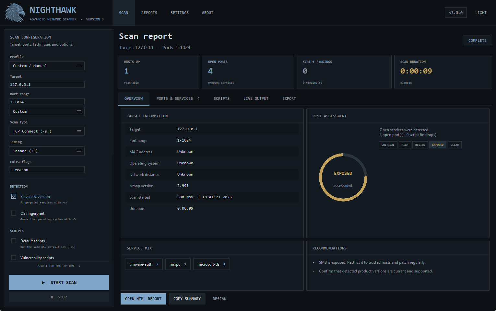
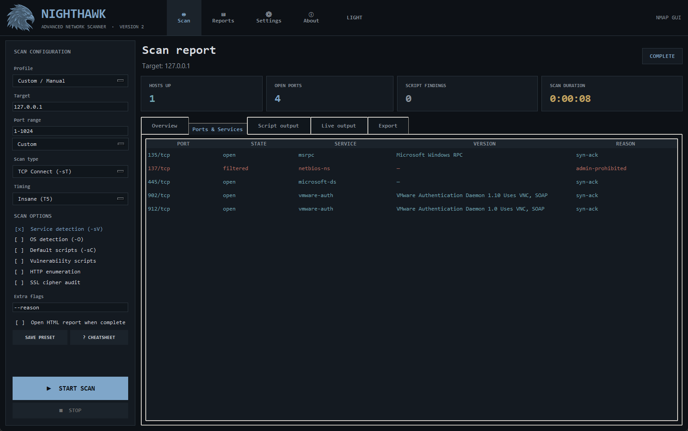
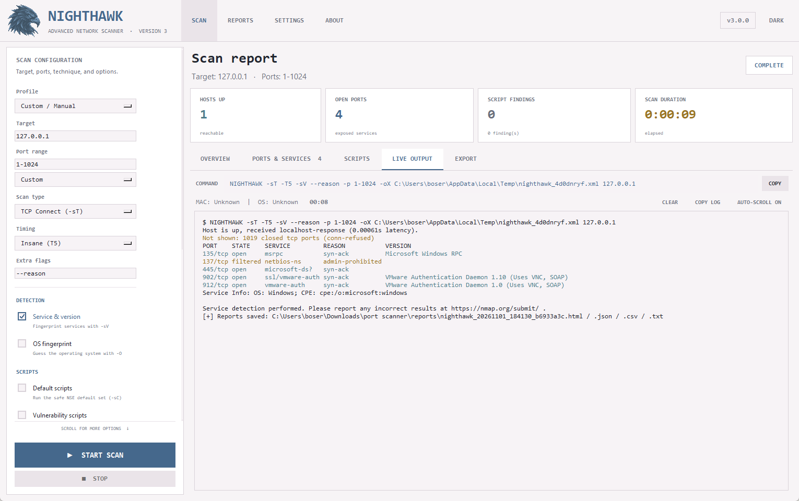
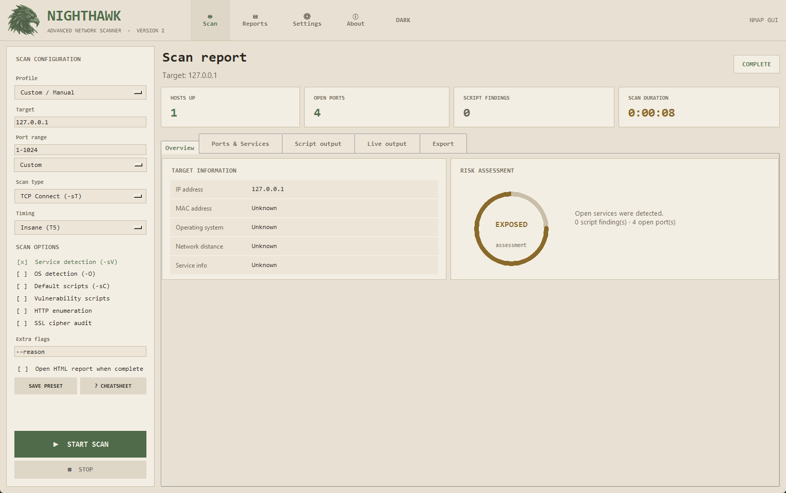
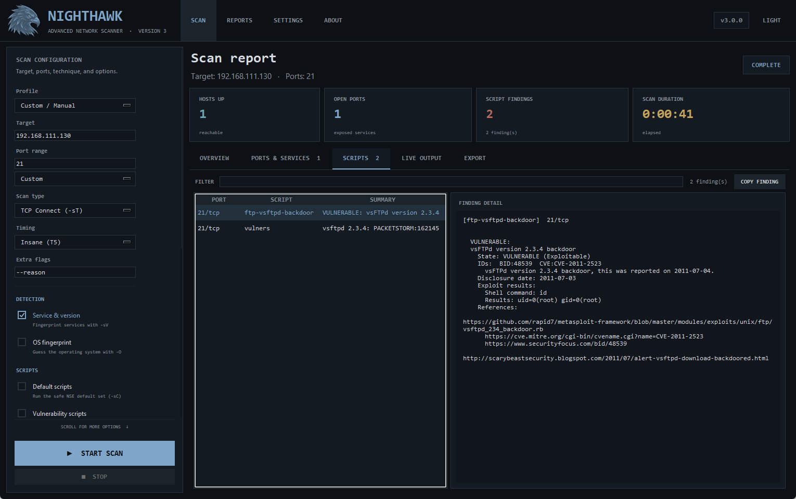
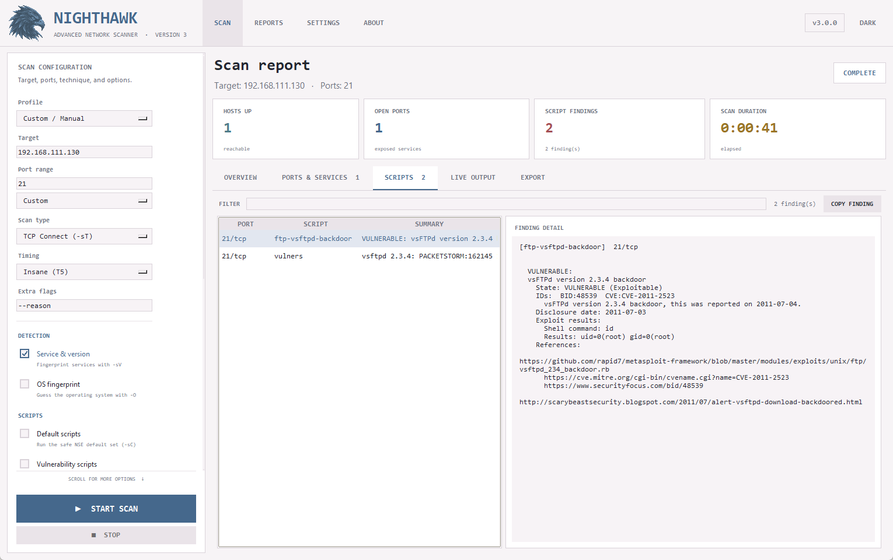
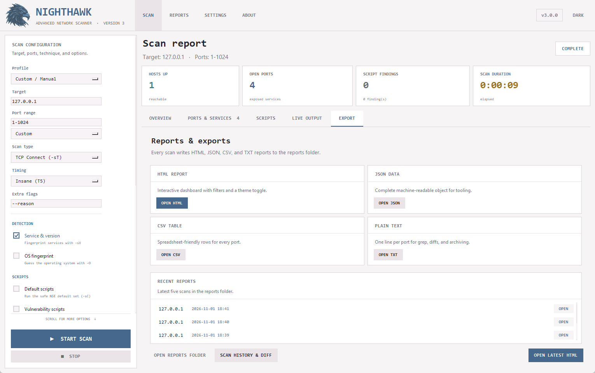

# NIGHTHAWK 4.0.0

A desktop Nmap scanner with a Version 4 security dashboard. NIGHTHAWK turns command-line network scanning into a point-and-click workflow — scan configuration, live output, risk assessment, service insights, and browser reports — with **zero Python package dependencies**.

> ⚠️ **Only scan hosts you own or have explicit permission to test.** Unauthorized scanning is illegal in most jurisdictions.

---

## Table of Contents

- [What's New in Version 4](#whats-new-in-version-4)
- [Features](#features)
- [Interface Tour](#interface-tour)
- [How It Works](#how-it-works)
- [Requirements](#requirements)
- [Installation](#installation)
  - [Linux — Kali / Debian / Ubuntu](#linux--kali--debian--ubuntu)
  - [Windows](#windows)
  - [macOS](#macos)
- [Using NIGHTHAWK](#using-nighthawk)
- [Reports](#reports)
- [Command-Line Usage](#command-line-usage)
- [Project Structure](#project-structure)
- [Safety & Security Design](#safety--security-design)
- [Troubleshooting](#troubleshooting)
- [Contributing](#contributing)
- [License](#license)
- [Author](#author)

---

## What's New in Version 4

Version 4 builds on the Version 3 package architecture with safer scan execution, richer multi-host reporting, and more reliable report cleanup.

<p align="center">
  
  <br>
  <sub>Version 4 — button-style tabs, metric cards, risk legend, service mix, and recommendations.</sub>
</p>

| Area | What changed |
|---|---|
| **Architecture** | `scanner.py` is now a tiny launcher; the app lives in `nighthawk_app/` with separate scanning, reports, theme, and UI modules |
| **Tabs** | Real button-style tabs with live counts, an accent underline, and `Ctrl+1…5` shortcuts |
| **Scan options** | Full-row checkbox rows with hints replace the old text toggles; six new options were added |
| **New flags** | Traceroute, open-ports-only, skip discovery, DNS toggle, verbose output, and port reasons |
| **Overview** | Nmap version, start time, duration, risk legend, service mix, recommendations, and quick actions |
| **Ports** | Search, state filter, sortable headings, row copy, and open/service/row counts |
| **Scripts** | Findings list plus a detail pane, search, and copy |
| **Live output** | Elapsed timer, auto-scroll toggle, copy log, and copy command |
| **Export** | Format cards for HTML/JSON/CSV/TXT, recent reports, and folder shortcuts |
| **Reports** | The standalone report gained a service mix, recommendations, and a scan-configuration panel |
| **Reliability** | Temporary XML scan data is cleaned up on success and failure, report inputs are size-limited, and cleanup errors are surfaced |
| **Multi-host reporting** | Reports now include host totals, port summaries, open-port counts, and script-finding counts |
| **Validation** | Scan configuration, targets, ports, and custom flags are validated before execution; unsafe output overrides remain blocked |
| **Dialogs** | Searchable cheatsheet, settings window, richer about window, and a checkbox host picker |
| **Themes** | Blue-charcoal dark theme and a clean white-and-blue light theme, both switchable and remembered |

---

## Features

### Scanning
- **11 scan types** — TCP Connect (`-sT`), TCP SYN (`-sS`), UDP (`-sU`), FIN/Xmas/NULL/ACK/Window/Maimon, Ping Discovery (`-sn`), IP Protocol (`-sO`).
- **Firewall / IDS evasion** — packet fragmentation (`-f`), custom MTU, decoys (`-D RND:10`), MAC spoofing, bad checksums, idle scan, source-port spoofing.
- **Timing templates** — `-T0` (Paranoid) through `-T5` (Insane).
- **Detection options** — service/version (`-sV`) and OS fingerprinting (`-O`).
- **NSE scripts** — default (`-sC`), vulnerability (`vuln`), HTTP enumeration (`http-enum`), SSL cipher audit (`ssl-enum-ciphers`).
- **Output and routing options** — traceroute, open-port result handling, `-Pn`, `-n`, `-v`, and `--reason`.
- **Custom flags** field for advanced users, with dangerous flags blocked.
- **CIDR subnet sweep** — enter `192.168.1.0/24`, NIGHTHAWK discovers live hosts, then lets you pick which to scan.
- **Presets** — Quick TCP · Intense Scan · Stealth SYN · Evade Firewall · Ping Sweep.
- **Saved presets** — name the current form and reload it later from the sidebar.

### Reporting
- **Four formats written per scan:** `.html` · `.json` · `.csv` · `.txt` — all saved to `reports/`.
- **Interactive HTML report** — summary cards, risk badge, service mix, recommendations, scan configuration, port table, script output, live filter box, JSON/CSV/TXT downloads, and a dark / light toggle that remembers your choice.
- **Scan history & diff** — pick any two past scans and see which ports opened or closed.

### Usability
- Background scanning — the UI never freezes.
- Live Nmap output with color-coded lines (cyan = open, brass = filtered/closed, brick = error).
- Live MAC / OS lookup and an elapsed timer.
- Auto-open HTML report toggle.
- Preferences auto-save to `nighthawk_config.json`, including every option toggle.
- Searchable Nmap cheatsheet, settings window, and Version 4 about window.

<p align="center">
  
  <br>
  <sub>Ports &amp; Services — sortable columns, state filter, row copy, and per-port reasons.</sub>
</p>

---

## Interface Tour

### Header
Logo, wordmark, navigation (**Scan · Reports · Settings · About**), the version chip, and the **Light/Dark** switch. Every theme choice is saved.

### Sidebar
A scrollable scan form: profile, target, ports + preset, scan type, timing, extra flags, then the option checklist grouped into **Detection**, **Scripts**, and **Discovery & Output**. Start/Stop stay pinned at the bottom.

### Tabs

| Tab | Purpose |
|---|---|
| **Overview** | Target facts, risk ring and legend, service mix, recommendations, and quick actions |
| **Ports & Services** | Searchable, filterable, sortable table with counts and clipboard copy |
| **Scripts** | NSE findings browser with a detail pane and search |
| **Live output** | Command preview, streaming log, timer, auto-scroll, and copy controls |
| **Export** | Report format cards, recent reports, and folder shortcuts |

### Keyboard shortcuts

| Keys | Action |
|---|---|
| `Ctrl+1…5` | Switch tabs |
| `Ctrl+R` | Start a scan |
| `Ctrl+.` | Stop the running scan |
| `Ctrl+L` | Focus the port filter |
| `Ctrl+T` | Toggle the theme |
| `Ctrl+H` | Open scan history |

---

## How It Works

### High-level flow

```
User launches scanner.py
        │
        ▼
nighthawk_app.cli → NighthawkApp
        │
        ▼
User fills: target · ports · scan type · timing · options
        │
        ▼
Click START SCAN
        │
        ▼
Target contains "/"?
   │                    │
  YES                   NO
   │                    │
   ▼                    ▼
Subnet sweep       build_command() + validate
(nmap -sn)              │
   │                    ▼
   ▼              Launch worker thread
Checklist of            │
live hosts              ▼
   │              subprocess.Popen(nmap -oX temp.xml)
   ▼                    │
User picks IPs          ▼
   │              Stream stdout → live log + timer
   └──────────────►     │
                        ▼
                  Nmap exits (code 0)
                        │
                        ▼
                  parse_nmap_xml()
                        │
                        ▼
                  write_reports() + render_report()
                        │
                        ▼
                  refresh_dashboard() — every tab
                        │
                        ▼
                  Auto-open HTML (optional)
```

<p align="center">
  
  <br>
  <sub>Live output — command preview, elapsed timer, auto-scroll, and copy controls.</sub>
</p>

### Scan execution pipeline

1. **`ScanMixin.start_scan()`** — reads the form and checkbox rows, persists preferences, validates the target/ports/flags, and asks `scanning.options.build_command()` for a **list** of arguments (never a shell string).
2. **`ScanMixin._execute_command()`** — switches to the Live tab, locks Start, enables Stop, starts the spinner and timer, and launches a daemon thread.
3. **`ScanMixin.run_scan()`** — runs `subprocess.Popen(nmap)` and streams stdout. Every UI update is marshalled through `root.after(0, …)`.
4. **`ReportMixin.create_reports()`** — calls `parse_nmap_xml()` from `scanning/parser.py` to flatten every host/port/script into records plus feature flags.
5. **`ReportMixin._finalize_reports()`** — writes JSON/CSV/TXT with `reports/exporters.py`, renders the standalone page with `reports/html.py`, then refreshes the dashboard.
6. **`NighthawkApp.refresh_dashboard()`** — updates metric cards, overview facts, risk, ports, scripts, and export cards.

### Module map

| Module | Responsibility |
|---|---|
| `nighthawk_app/app.py` | Window layout, tab switching, shortcuts, refresh orchestration |
| `nighthawk_app/theme.py` | Palettes, ttk styles, live theme switching |
| `nighthawk_app/config.py` | Preference defaults and persistence |
| `nighthawk_app/paths.py` | Project, report, config, and asset locations |
| `nighthawk_app/scanning/options.py` | Scan types, profiles, option metadata, validation, command builder |
| `nighthawk_app/scanning/parser.py` | Nmap XML → plain dictionaries |
| `nighthawk_app/scanning/runner.py` | Threading, streaming, aborts, subnet sweep |
| `nighthawk_app/reports/risk.py` | Shared severity engine |
| `nighthawk_app/reports/insights.py` | Service mix, recommendations, version labels |
| `nighthawk_app/reports/exporters.py` | JSON, CSV, and TXT writers |
| `nighthawk_app/reports/html.py` | Standalone HTML report renderer |
| `nighthawk_app/ui/widgets.py` | Panels, metric cards, checkbox rows, tab bar, scroll frame |
| `nighthawk_app/ui/header.py` | Brand, navigation, version chip, theme switch |
| `nighthawk_app/ui/sidebar.py` | Scrollable scan form and saved presets |
| `nighthawk_app/ui/tabs/` | Overview, ports, scripts, live, and export tabs |
| `nighthawk_app/ui/dialogs.py` | History, cheatsheet, settings, about, host picker |

### Threading model

Tkinter is **not thread-safe** — a background thread must never call `widget.config()` directly. NIGHTHAWK solves this by marshalling every UI change through `root.after(0, callable, *args)`, which queues the callable and executes it on the main thread at the next idle moment. The worker thread only runs `subprocess.Popen`, reads stdout, and queues callables.

### Risk assessment

The same `assess()` function drives the desktop gauge and the HTML report badge:

| Severity | Triggered when… |
|---|---|
| **CRITICAL** (oxblood) | Any script output contains `exploit`, `remote code execution`, or `critical` |
| **HIGH RISK** (brick) | Any script output contains `vulnerable`, `cve-`, or `high severity` |
| **REVIEW** (amber) | Any script returned output at all |
| **EXPOSED** (brass) | Any port is in the `open` state |
| **CLEAR** (cyan-blue) | No open ports and no script findings |

---

## Requirements

| Component | Version | Notes |
|---|---|---|
| **Python** | 3.9 or newer | Must include Tkinter |
| **Tkinter** | Bundled with Python | On Linux, install `python3-tk` separately |
| **Nmap** | Any recent version | Must be available on `PATH` |
| **pip packages** | **None** | NIGHTHAWK uses only the Python standard library |

---

## Installation

### Linux — Kali / Debian / Ubuntu

```bash
# 1. Clone the repository
git clone https://github.com/r4tnadeepbose/NIGHTHAWK.git
cd NIGHTHAWK

# 2. Install system dependencies
sudo apt update
sudo apt install -y nmap python3 python3-tk

# 3. Check everything is present
./requirements.txt

# 4. Launch NIGHTHAWK
./scanner.py
```

Use **elevated privileges only for scan types that require raw packets** — TCP SYN (`-sS`), UDP (`-sU`), OS detection (`-O`), and most evasion modes:

```bash
sudo -E ./scanner.py
```

**Useful Make targets:**

```bash
make check       # verify Python, Tkinter, and Nmap are installed
make man         # preview the manual page (man ./nighthawk.1)
```

**System-wide install:**

```bash
sudo ./install.sh
nighthawk        # run from anywhere
```

### Windows

1. Download the [NIGHTHAWK ZIP](https://github.com/r4tnadeepbose/NIGHTHAWK/archive/refs/heads/main.zip) and extract it.
2. Install **Python 3.9+** from [python.org](https://www.python.org/downloads/) — tick **Add Python to PATH** during setup.
3. Install **Nmap** from [nmap.org](https://nmap.org/download.html) and make sure it is added to `PATH`.
4. Open PowerShell in the extracted folder and run:

```powershell
cd "$HOME\Downloads\NIGHTHAWK-main"
py .\scanner.py
```

If the `py` launcher isn't available, use:

```powershell
python .\scanner.py
```

> **Windows note:** TCP SYN, UDP, and OS detection require Administrator privileges. Right-click PowerShell → **Run as administrator** before launching.

### macOS

```bash
brew install nmap python-tk
git clone https://github.com/r4tnadeepbose/NIGHTHAWK.git
cd NIGHTHAWK
python3 scanner.py
```

Raw-packet scans require `sudo`:

```bash
sudo python3 scanner.py
```

---

## Using NIGHTHAWK

<p align="center">
  
  <br>
  <sub>The light theme — the same dashboard, switched with the Light / Dark button.</sub>
</p>

### Basic scan

1. **Enter a target** in the sidebar — a hostname (`scanme.nmap.org`), an IP address (`192.168.1.1`), or a CIDR range (`192.168.1.0/24`).
2. **Choose ports** — free-form (`22,80,443`, `1-1024`) or a preset (**Top 100**, **Top 1000**, **All**).
3. **Choose a scan type** — e.g. *TCP Connect (-sT)* for non-root, *TCP SYN (-sS)* for stealth.
4. **Choose timing** — `-T3` (Normal) is safe; `-T5` (Insane) is fast but noisy.
5. **Tick options** — service detection, OS detection, scripts, traceroute, open-only, and more.
6. Click **▶ START SCAN**.

### Watching the scan

- The app switches to **Live output** automatically.
- The command preview shows the exact Nmap arguments, with a copy button.
- The timer counts elapsed time; **Clear**, **Copy log**, and **Auto-scroll** control the console.
- The MAC / OS strip updates as Nmap learns more about the host.

### Reviewing results

- **Overview** — target facts, risk gauge with legend, service mix, recommendations, and quick actions.
- **Ports & Services** — filter by text or state, sort any column, and copy a row.
- **Scripts** — browse findings by port/script and read the full output.
- **Export** — open any of the four formats or a recent report.

<p align="center">
  
  
  <br>
  <sub>Scripts tab in both themes — findings list, detail pane, search, and copy.</sub>
</p>

### Subnet sweep

If the target contains a `/` (e.g. `192.168.1.0/24`), NIGHTHAWK first runs `nmap -sn <CIDR>` to discover live hosts, then shows a checkbox list so you can pick which ones to scan in depth.

### Scan history & diff

Open **Reports** in the header:

- Every completed scan appears as a row (`date · target · ports · open ports · findings`).
- Ctrl-click **two rows**, then click **COMPARE SELECTED** — the right panel lists newly opened (`+`) and no-longer-open (`-`) ports.
- Double-click any row to open its HTML report.

### Presets and saved forms

- **Profile** loads a built-in configuration:

| Profile | What it does |
|---|---|
| **Quick TCP (Top 100)** | Fast `-sT` scan against the 100 most common ports, `-sV`, `-T5` |
| **Intense Scan (All)** | Full `-sT` scan against every port, `-sV -O -T4` |
| **Stealth SYN (Root)** | `-sS` on ports 1–1024, `-sV`, `-T1` (needs root) |
| **Evade Firewall** | Fragmented `-f` scan on ports 1–1024, `-sV`, `-T2` |
| **Ping Sweep** | `-sn` host discovery only, `-T3` |

- **SAVE PRESET** stores the full form (including every checkbox) under a name; the saved-preset menu appears below it.
- **? CHEATSHEET** opens a searchable Nmap reference.

---

## Reports

Every completed scan writes **four matching files** to `reports/`:

```
reports/nighthawk_YYYYMMDD_HHMMSS_<id>.{html,json,csv,txt}
```

| Format | Purpose |
|---|---|
| **`.html`** | Interactive standalone dashboard report |
| **`.json`** | Machine-readable scan object, including the command and active options |
| **`.csv`** | Spreadsheet-friendly rows (formula-injection protected) |
| **`.txt`** | One line per port, ideal for diffs or grep |

<p align="center">
  
  <br>
  <sub>Export tab — format cards, recent reports, and folder shortcuts.</sub>
</p>

### What's inside the HTML report

- **Header** — logo, target, port range, timestamp, `SCAN COMPLETE`, and a dark / light toggle.
- **Summary cards** — hosts up · open ports · script findings · ports scanned.
- **Target information** — target · port range · MAC · OS · distance · Nmap version · start time · duration.
- **Risk assessment** — the same Clear / Exposed / Review / High Risk / Critical decision as the app.
- **Service mix and recommendations** — derived from the open ports and NSE findings.
- **Scan configuration** — the exact command and active flags.
- **Ports & services table** — searchable by port, state, service, or version.
- **Script output** — every NSE finding.
- **Export buttons** — download JSON, CSV, and TXT from the browser.

The HTML file is **fully standalone** — CSS, JavaScript, and data are embedded, so you can email it or archive it without dependencies.

### Optional static hosting

NIGHTHAWK is a local desktop application and does not run on Vercel. Its standalone
HTML reports can be hosted as static files, but scan reports may contain sensitive
host, service, and vulnerability information. Publish only reports you have
reviewed and are authorized to share:

1. Copy the selected `.html` report and its matching `.json`, `.csv`, and `.txt`
   files into a separate static-site project.
2. Deploy that project with the Vercel CLI or a connected Vercel Git repository.
3. Keep the desktop scanner and Nmap execution local; Vercel only serves the
   finished static artifacts.

---

## Command-Line Usage

```bash
./scanner.py --help      # print usage information
./scanner.py --version   # print version

python -m nighthawk_app --version
```

Example `--help` output:

```
NIGHTHAWK 4.0.0 - Advanced Network Scanner

Usage: ./scanner.py [OPTIONS]
       python -m nighthawk_app [OPTIONS]

Options:
  -h, --help       Show this help message and exit.
  -V, --version    Show version information and exit.

Requirements:
  Python 3.9 or newer with Tkinter, and Nmap on PATH.
  Run ./requirements.txt to check or install Linux prerequisites.

Reports:
  Completed scans are written to ./reports/ as HTML, JSON, CSV, and TXT files.

Packages:
  nighthawk_app.scanning   option metadata, XML parsing, process runner
  nighthawk_app.reports    risk engine, exporters, standalone HTML report
  nighthawk_app.ui         header, sidebar, tabs, dialogs, widgets

Only scan hosts you own or have permission to test.
```

---

## Project Structure

```
NIGHTHAWK/
│
├── scanner.py                    ← tiny launcher (./scanner.py still works)
├── nighthawk_app/
│   ├── __init__.py               ← name, version, tagline
│   ├── __main__.py               ← python -m nighthawk_app
│   ├── app.py                    ← window, tabs, shortcuts, refresh flow
│   ├── cli.py                    ← --help / --version / launch
│   ├── config.py                 ← defaults and saved preferences
│   ├── paths.py                  ← project, report, config, asset paths
│   ├── theme.py                  ← palettes, ttk styles, theme switching
│   │
│   ├── assets/
│   │   ├── logo.png              ← original mark
│   │   └── logo_muted.png        ← dashboard/report mark
│   │
│   ├── scanning/
│   │   ├── options.py            ← scan types, profiles, checkboxes, validation
│   │   ├── parser.py             ← Nmap XML → plain dictionaries
│   │   └── runner.py             ← threading, streaming, aborts, subnet sweep
│   │
│   ├── reports/
│   │   ├── risk.py               ← shared severity engine
│   │   ├── insights.py           ← service mix and recommendations
│   │   ├── exporters.py          ← JSON / CSV / TXT writers
│   │   ├── html.py               ← standalone report renderer
│   │   └── report_mixin.py       ← report orchestration and opening
│   │
│   └── ui/
│       ├── widgets.py            ← panels, cards, checkbox rows, tab bar
│       ├── header.py             ← brand, navigation, theme switch
│       ├── sidebar.py            ← scrollable scan form and presets
│       ├── dialogs.py            ← history, cheatsheet, settings, about
│       └── tabs/
│           ├── overview.py       ← facts, risk, service mix, recommendations
│           ├── ports.py          ← filter, sort, copy, counts
│           ├── scripts.py        ← findings browser
│           ├── live.py           ← streamed log, timer, log tools
│           └── export.py         ← format cards and recent reports
│
├── tests/
│   └── test_core.py                ← validation, command, risk, and report tests
│
├── nighthawk_config.json         ← saved preferences (created on first run)
├── requirements.txt              ← dependency checker (executable)
├── install.sh                    ← Linux system-wide installer
├── Makefile                      ← make check / make man
├── nighthawk.1                   ← man page
├── nighthawk                     ← portable launcher
├── README.md
├── HELP.md
├── screenshots/                  ← README captures (dark + light)
│
├── .vscode/                      ← optional editor settings
│
└── reports/                      ← auto-created; holds all completed scans
    ├── nighthawk_20240115_143012_a1b2c3d4.html
    ├── nighthawk_20240115_143012_a1b2c3d4.json
    ├── nighthawk_20240115_143012_a1b2c3d4.csv
    └── nighthawk_20240115_143012_a1b2c3d4.txt
```

---

## Safety & Security Design

NIGHTHAWK is built to be safe by default — even though it wraps a powerful tool.

| Guard | What it protects against |
|---|---|
| **Blocked Nmap flags** | `-oN`, `-oX`, `-oG`, `-oA`, `-iL`, `-iR`, `--datadir`, `--stylesheet`, `--webxml`, `--resume`, `--append-output` — these could overwrite report files or read arbitrary data, so they are rejected |
| **Port validation** | Expressions are parsed, bounded to 1–65535, and length-limited before reaching Nmap |
| **List-form command building** | The command is a Python **list**, not a shell string — there is no `shell=True`, so shell injection is impossible |
| **CSV formula-injection guard** | Any cell beginning with `=`, `+`, `-`, or `@` is prefixed with a single quote |
| **HTML escaping** | Every user-controlled string is passed through `html.escape()` before entering the report |
| **Thread-safe UI** | All background-thread UI updates are marshalled through `root.after(0, …)` |
| **Temporary files** | Nmap's XML output goes to a `tempfile.mkstemp()` path and is deleted after parsing |
| **Config failure tolerance** | A corrupted `nighthawk_config.json` silently falls back to safe defaults |

---

## Troubleshooting

| Symptom | Fix |
|---|---|
| `Nmap not found. Install it and add it to PATH.` | Install Nmap from [nmap.org](https://nmap.org/download.html) or `apt install nmap`, then restart your terminal |
| `ModuleNotFoundError: No module named 'nighthawk_app'` | Run from the project root (`./scanner.py`) or add the repository folder to `PYTHONPATH` |
| `ModuleNotFoundError: No module named 'tkinter'` | `sudo apt install python3-tk` (Linux) — Tkinter is bundled on Windows/macOS |
| Scans return all `filtered` | Host firewall is blocking Nmap. Try `-Pn` and a lower timing (`-T2`) |
| SYN / UDP / OS detection returns nothing | You need root. Run `sudo -E ./scanner.py` |
| Report opens but is blank | Check that `reports/` isn't read-only; check the Live output for `[ERROR]` lines |
| `Permission denied` on `./scanner.py` | `chmod +x scanner.py` |

---

## Contributing

Contributions are welcome. For any significant change please open an **issue** first to discuss what you'd like to change.

```bash
# Fork → clone → branch
git checkout -b feature/my-feature

# Make your change, then:
python3 -m compileall nighthawk_app scanner.py   # syntax check
python3 -m unittest discover -s tests -v         # run the core tests
make check                                        # verify environment

git commit -m "feat: describe your change"
git push origin feature/my-feature
```

UI code lives in `nighthawk_app/ui/`. New tabs go in `ui/tabs/`, new scan options are declared in `scanning/options.py`, and new report sections belong in `reports/html.py`.

---

## License

No license file is currently included. Add one — **MIT** is a good default for portfolio projects.

---

## Author

**Ratnadeep Bose**
- GitHub: [@r4tnadeepbose](https://github.com/r4tnadeepbose)
- Repository: [github.com/r4tnadeepbose/NIGHTHAWK](https://github.com/r4tnadeepbose/NIGHTHAWK)

---

> **Legal notice:** Nmap is a legitimate security tool used by professionals. However, scanning networks you don't own or lack explicit permission to test is **illegal** in most countries. NIGHTHAWK's authors accept no liability for misuse. Only scan hosts you own or have written authorization to test.
